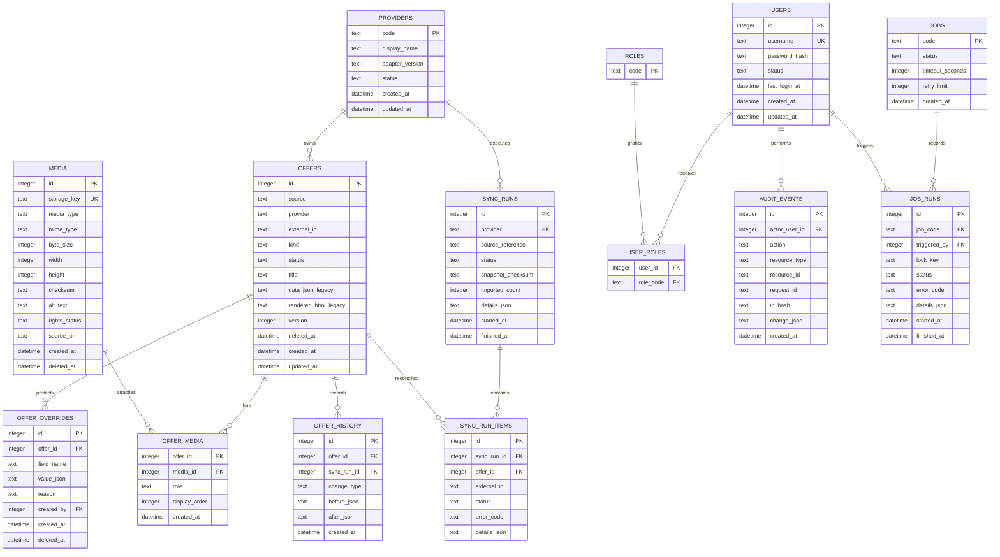

# Evolução do modelo de dados

## Status e limites

Este documento é o contrato de planejamento da evolução do SQLite local. A
`migrations/001_initial.sql` permanece imutável e nenhuma migration nova é
aplicada por esta task. A produção estática, o fallback HTML e o snapshot
`data/operator-sync.json` continuam inalterados.

O modelo abaixo separa o núcleo do catálogo das preocupações que ainda serão
implementadas: mídia, identidade administrativa, auditoria, overrides de
provider e jobs. A implementação deve ser incremental, compatível com os
registros atuais e sempre precedida de backup no ambiente que receber a
migration.

## Modelo atual

```text
offers
  id (PK)
  source, provider, external_id (UNIQUE)
  kind, title, catalog fields, status, ordering
  data_json, rendered_html
  created_at, updated_at

sync_runs
  id (PK)
  provider, source_reference, status, imported_count
  details_json, started_at, finished_at
```

Pontos de compatibilidade:

- `offers(provider, external_id)` continua sendo a identidade externa do
  registro automático;
- `data_json` continua disponível durante a transição para colunas/entidades
  normalizadas;
- `rendered_html` continua servindo o fallback e não deve ser recalculado por
  uma migration;
- pacotes manuais continuam distinguíveis por `source = 'manual'`;
- `sync_runs` continua sendo a referência de uma importação completa.

## ERD alvo incremental



O diagrama é um alvo de domínio, não uma instrução para criar todas as
tabelas em uma única migration. Colunas `password_hash`, `change_json` e
`details_json` têm regras próprias de acesso, retenção e redaction definidas
nas tasks de segurança, dados e privacidade.

## Invariantes e constraints

1. `offers(provider, external_id)` permanece único para registros externos.
2. `source`, `kind`, `status`, `media.role`, `rights_status` e estados de job
   usam `CHECK`/allowlist; valores desconhecidos são rejeitados.
3. Relações entre oferta, mídia, override, histórico, usuário e job usam
   foreign keys com `PRAGMA foreign_keys = ON` em toda conexão.
4. `offer_media(offer_id, media_id, role)`, `user_roles(user_id, role_code)` e
   `sync_run_items(sync_run_id, external_id)` são únicos para impedir vínculos
   duplicados e reprocessamento ambíguo.
5. Exclusões de catálogo e mídia são soft delete/quarentena quando houver
   dependência histórica ou de backup; limpeza física é uma operação separada.
6. Alterações de uma oferta e seus eventos de auditoria acontecem na mesma
   transação.
7. Sync automático é idempotente por `(provider, external_id)` e não pode
   apagar o last-known-good por falha parcial.
8. Overrides manuais não são armazenados como uma mutação indistinguível do
   valor recebido pelo provider.
9. Timestamps são UTC em formato consistente e `updated_at` muda em toda
   alteração de negócio.
10. Índices são adicionados somente após `EXPLAIN QUERY PLAN` e workload
   representativo; não se indexa toda coluna por padrão.

## Plano de migrations

| Versão proposta | Conteúdo | Compatibilidade e rollback |
|---|---|---|
| `001_initial.sql` | Schema atual de `offers` e `sync_runs` | Já aplicada; nunca editar. |
| `002_offer_lifecycle.sql` | `version`, `deleted_at`, referência segura de sync e constraints compatíveis | Backfill idempotente; restore do backup pré-migration. |
| `003_media.sql` | `media` e `offer_media`, incluindo índices e estados | Não altera `image_url` existente; dual-read até validação. |
| `004_provider_sync.sql` | `providers`, `sync_run_items`, checksum e reconciliação | Importa em staging e só promove lote validado. |
| `005_admin_identity.sql` | `users`, `roles`, `user_roles`, sessões/revogação conforme desenho de segurança | Migração inicia sem remover o acesso local legado; remoção só após testes. |
| `006_audit.sql` | `audit_events` e índices de consulta restrita | Eventos novos são append-only; retenção documentada. |
| `007_overrides_history.sql` | `offer_overrides` e `offer_history` | Reprocessamento do snapshot deve ser determinístico. |
| `008_jobs.sql` | `jobs`, `job_runs` e locks/leases | Jobs começam desabilitados até observabilidade e testes. |

As versões são uma sequência proposta. A ordem definitiva, SQL e backfill só
serão criados nas tasks filhas correspondentes, após revisão do ERD e testes em
banco limpo e fixture existente.

## Política de execução e rollback

1. Gerar backup verificável de banco e mídia antes de qualquer migration.
2. Executar migration em cópia limpa e em fixture representativa do banco
   atual; comparar contagens, constraints e `PRAGMA integrity_check`.
3. Marcar a versão em `schema_migrations` somente após o script inteiro
   concluir; falha deve fazer rollback da transação quando suportado.
4. Não editar migration aplicada. Correção posterior recebe nova versão ou
   restaura o backup pré-migration e aplica um forward-fix revisado.
5. Readiness, smoke público/admin e integridade das referências de mídia são
   pré-requisitos para promover o artefato.
6. Nenhuma migration deste plano deve ser executada contra produção nesta
   etapa do projeto.

## Decisões pendentes

- confirmar se `provider` continuará texto controlado ou será FK para
  `providers` após o primeiro backfill;
- definir retenção de `offer_history`, `audit_events`, backups e mídia órfã;
- definir política de criptografia em repouso e destino externo dos backups;
- validar juridicamente campos que possam conter dados pessoais;
- escolher estratégia futura de object storage sem acoplar o domínio ao
  fornecedor.

## Auditoria implementada nesta etapa

`migrations/005_audit_append_only.sql` torna `audit_events` append-only, com
exceção técnica de purge controlado pela janela `AUDIT_RETENTION_DAYS` (365
dias por padrão, configurável entre 30 e 3650). A leitura ocorre somente em
`/api/admin/audit` para o papel `admin`; segredos não são armazenados e a
origem é representada por hash. A definição jurídica do prazo e do owner
empresarial continua necessária antes de produção.

Essas decisões não podem ser inferidas apenas do schema atual e devem ser
registradas antes das migrations correspondentes.
